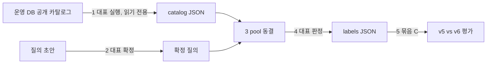

# 추천 라벨 도구 사용법

> hybrid_v5와 hybrid_v6을 사람 라벨로 비교하려고, 대표가 질의 조건을 확정하고 후보를 블라인드로 0~3점 판정하는 절차입니다.

2026-10-21 · 묶음 B(S4-02) · 상태: **라벨 대기** (사람 라벨 0건)

**세 줄 요약**

- 라벨은 로컬 CLI `scripts/label_recommendations.py`로 답니다. 점수·순위·모델 이름은 화면에 나오지 않고(시험으로 고정), 키 하나로 판정하며, 키를 누를 때마다 저장됩니다.
- 질의마다 v5 top-10 ∪ v6 top-10 ∪ 60개 pool v5 top-10 ∪ 무작위 5곳만 판정합니다(pooled). 평가기는 판정하지 않은 후보를 0점으로 채우지 않고 `judged@5`를 함께 보고합니다.
- 운영 자료로 pool을 만드는 첫 단계는 비밀 설정이 필요해 대표가 직접 실행합니다. 지금까지 실행한 것은 합성 자료 시험뿐입니다.

## 대표 할 일

- [ ] 1. 공개 카탈로그를 내보냅니다(운영 DB 읽기 전용). [명령](#1-공개-카탈로그-내보내기-대표-실행)
- [ ] 2. `evals/recommendation/queries/v6-label-queries.json` 초안을 고치고 확정합니다. 모든 질의에 `human_query`(대표가 쓴 한 줄 요청)가 있어야 확정되며, food는 취향 태그, price는 예산 상한도 채워야 합니다.
- [ ] 3. pool을 동결합니다. 출력에 나오는 판정 수, 예상 시간, PRD 예산 초과 경고, 부족 보고를 확인합니다.
- [ ] 4. holdout부터 라벨을 답니다. 중간에 `q`로 끝내도 이어서 할 수 있습니다.
- [ ] 5. 아래 결정 4개를 정합니다. [결정할 것](#대표가-결정할-것)

## 웹 화면 대신 CLI를 고른 이유

라벨을 가장 빨리 시작할 수 있는 쪽이 CLI라서 골랐습니다.

| 기준 | CLI (선택) | 관리자 웹 화면 |
|---|---|---|
| 인증 표면 | 새 네트워크 표면 0. 비밀이 있는 운영자 컴퓨터에서만 실행 | `admin_research` 범위의 조회·저장 API, CSRF·역할 검사, 서버의 pool 보관이 새로 필요 |
| 저장 위치 | 저장소 `evals/recommendation/labels/`에 바로 기록 | Render 서버는 저장소에 쓸 수 없어 따로 내보내는 단계가 필요 |
| 단축키 | 표준 라이브러리 `tty`/`termios`로 키 하나 입력. 설치 0 | JS·index.html·자산 해시 수정. 3단계가 동시에 고치는 `foundation.js`와 충돌 위험, "새 메뉴 금지"와 충돌 |
| 시험 | 키 입력을 주입해 pytest로 고정 | route·service·JS 시험이 따로 필요 |

관리자 전용 조건은 이렇게 지킵니다. 운영 자료는 비밀 env 파일이 있어야 내보낼 수 있고, 라벨 도구는 동결된 로컬 JSON만 읽습니다.

## 흐름



| 파일 | 위치 | Git |
|---|---|---|
| 카탈로그(공개 장소 전체) | `data/recommendation-labels/` 권장 | 제외(`data/*` gitignore) |
| 질의 조건 | `evals/recommendation/queries/v6-label-queries.json` | 포함 |
| 동결 pool | `evals/recommendation/pools/` | 제외(기본값, `.gitignore`. 바꾸려면 대표 결정) |
| 라벨 | `evals/recommendation/labels/` | 포함 |

## 실행 명령

모든 명령은 저장소 루트에서 실행합니다. Python은 `~/.venvs/travel-inbox-rag/bin/python`입니다.

### 1. 공개 카탈로그 내보내기 (대표 실행)

```bash
mkdir -p data/recommendation-labels
PYTHON_DOTENV_DISABLED=1 ~/.venvs/travel-inbox-rag/bin/python scripts/export_v6_label_catalog.py \
  --env deploy/render-supabase/.env --output data/recommendation-labels/catalog-2026-10-21.json
```

읽는 범위는 제품과 같은 공개 규칙의 장소입니다. 승인된 검증 pack과 7일 TTL 안의 공개지도 pack, 그리고 활성·표시 허용 출처만 포함됩니다. trips·메일·숙소·보관함·제외·피드백·사용자 표는 읽지 않고 DB에 쓰지 않습니다. 리뷰 집계는 내보내지 않으며, 모든 후보가 `review_evidence=unavailable`로 들어갑니다. 2026-10-08 실제 활성 집계는 0건이었습니다[과거 값].

> [!WARNING]
> 공개지도 pack은 마지막 수집 뒤 7일이 지나면 제품에서도 보이지 않습니다. 도쿄 50곳은 2026-10-08 감사값이므로, 그 뒤에 새 요청으로 다시 수집되지 않았다면 내보내기 결과가 0곳일 수 있습니다[미확인]. 이 경우 배포 환경에서 실제 추천 요청으로 다시 수집한 뒤 내보냅니다. quota는 전역 20회/일, 사용자 5회/일입니다.

### 2. 질의 조건 확정

초안은 이미 만들어 두었습니다. 날짜·시각은 기계적으로 순환 배정했고, origin 시나리오의 출발점은 공개 지점 7곳을 순환합니다. 이 값은 기본값일 뿐이라 그대로는 확정되지 않습니다. 질의마다 `human_query`를 모델 순위를 보지 않고 직접 쓰고, 그때 날짜·시각·출발점도 함께 고친 뒤 확정합니다.

```bash
# 파일을 직접 고친 뒤, 확인한 ID만 확정
PYTHON_DOTENV_DISABLED=1 ~/.venvs/travel-inbox-rag/bin/python scripts/prepare_v6_label_queries.py \
  --output evals/recommendation/queries/v6-label-queries.json --confirm tokyo-11,tokyo-12
```

`--confirm-split holdout`도 남아 있지만, `human_query`가 빈 항목은 확정하지 않고 `blocked`로 돌려줍니다. 기계적 기본값만으로 일괄 확정되는 일은 없습니다.

| 필드 | 규칙 |
|---|---|
| `origin` | `null`(도시 중심 기준) 또는 `{"public_area": "center"}`. 가능한 값은 `center` `north` `east` `south` `west` `northeast` `southwest`. 좌표를 직접 넣으면 거부되며, 이 규칙이 개인 숙소 좌표를 막습니다 |
| `conditions.origin`·`conditions.origin_selection` | 넣으면 거부됩니다. snapshot의 `origin_selection`은 항상 `manual`(공개 지점) 또는 `none`이고 숙소 ID가 들어가지 않습니다 |
| 합성 숙소 | `{"public_area": "east", "synthetic_hotel": true}` |
| `section` | `reference`(주변 장소 참고하기), `local_discovery`, `landmark` |
| `human_query` | 대표가 쓴 한 줄 요청. **필수** |
| 확정 차단 | `human_query`, food의 `preferred.tags`, price의 `budget.amount_max` 중 하나라도 비어 있으면 확정되지 않음 |

### 3. pool 동결 (로컬, 네트워크 0)

```bash
PYTHON_DOTENV_DISABLED=1 ~/.venvs/travel-inbox-rag/bin/python scripts/prepare_v6_label_pool.py \
  --catalog data/recommendation-labels/catalog-2026-10-21.json \
  --queries evals/recommendation/queries/v6-label-queries.json \
  --output evals/recommendation/pools/v6-label-pool-2026-10-21.json
```

출력 JSON의 `by_split`(분할별 질의·판정 수·예상 시간·최악 판정 수), `holdout_over_prd_budget`, `shortfall`, `skipped`를 확인합니다. holdout 예상의 느린 쪽(판정당 25초)이 4시간을 넘으면 stderr에 경고가 나옵니다. 빠른 쪽(15초)도 넘으면 `holdout_certainly_over_prd_budget=true`입니다. 경고가 나오면 확정 질의 수나 도시를 줄인 질의 파일로 새 pool을 동결하거나, holdout을 먼저 달면서 진행률의 실측 속도를 보고 정합니다. 도구가 질의를 자동으로 줄이지는 않습니다.

pool 파일은 덮어쓰지 않습니다. 라벨이 pool 해시에 묶여 있으므로, 조건을 바꾸려면 새 파일 이름으로 다시 동결합니다. 순위 보기(`displayed`/`items_only`)는 pool에 들어가지 않으므로, 결정 1번을 정하기 전에 동결하고 라벨을 달아도 됩니다.

### 4. 라벨 달기

```bash
PYTHON_DOTENV_DISABLED=1 ~/.venvs/travel-inbox-rag/bin/python scripts/label_recommendations.py \
  --pool evals/recommendation/pools/v6-label-pool-2026-10-21.json \
  --labels evals/recommendation/labels/v6-labels-R1.json --reviewer-id R1 --split holdout
```

| 키 | 동작 |
|---|---|
| <kbd>0</kbd> <kbd>1</kbd> <kbd>2</kbd> <kbd>3</kbd> | 부적합 · 약간 관련 · 적합 · 매우 적합. 기록 후 다음 후보 |
| <kbd>r</kbd> | 짧은 이유 입력(200자, Enter로 끝) |
| <kbd>b</kbd> | 이전 후보로(다시 판정 가능) |
| <kbd>s</kbd> | 건너뛰기. 미판정으로 남고 다음 실행 때 다시 보임 |
| <kbd>q</kbd> | 저장 후 종료. 다시 실행하면 이어서 진행. <kbd>Ctrl</kbd>+<kbd>C</kbd>·<kbd>Ctrl</kbd>+<kbd>D</kbd>도 같은 방식으로 저장 후 종료 |
| <kbd>?</kbd> | 도움말 |

진행률은 질의마다 표시합니다(예: `질의 3/40 완료 · 판정 52/584 · 남은 예상 2시간 5분~3시간 28분`). 판정이 10개 이상 쌓이면 실측 평균으로 바꿔 계산합니다. 한 판정은 최대 120초까지만 계산에 넣어 자리를 비운 시간을 뺍니다. `--progress`를 붙이면 진행률만 출력합니다. `--reviewer-id`에는 가명만 쓸 수 있으며 이메일은 거부됩니다.

### 5. 평가 (묶음 C, 라벨 뒤)

```bash
PYTHON_DOTENV_DISABLED=1 ~/.venvs/travel-inbox-rag/bin/python scripts/evaluate_v6_labels.py \
  --pool evals/recommendation/pools/v6-label-pool-2026-10-21.json \
  --labels evals/recommendation/labels/v6-labels-R1.json \
  --ranking-view displayed \
  --output /tmp/going-v6-label-eval.json
```

`--ranking-view`는 기본값이 없는 필수 인자입니다(결정 1번). 승격 판단(`model_comparison`)은 고른 보기로만 계산하고, 다른 보기의 결과는 `alternate_views`에 보조로 함께 기록합니다. 보조 보기는 승격에 쓰지 않습니다. 평가는 pool 해시, 질의 snapshot 지문, 후보 사실 지문을 파일에 저장된 값이 아니라 **다시 계산해** 비교하므로, 라벨을 단 뒤 pool 파일을 고치면 거부됩니다.

## 블라인드 규칙

화면에는 질의 조건과 후보의 허용 사실만 seed 고정 무작위 순서로 나옵니다.

| 보이는 것 | 보이지 않는 것 |
|---|---|
| 도시·날짜·시간·인원·분류·출발점 이름·취향·예산·구획 이름 | 모델 점수(`score`, `utility`, `components`), `ranking_diagnostics`, `matched_tags` |
| 이름·분류·동네·주소·태그 | 모델 순위·순서 번호, 모델 이름(hybrid_v5/v6) |
| 사용 가능한(`usable`) 사실과 상태(확인됨 / 지도 정보 기준(잠정)) | 구획 자격·eligibility·reason code·`recommendation_types` |
| 공개지도 태그 중 cuisine·opening_hours·wheelchair·diet·website | 전화번호, 장소 ID, 어느 모델이 이 후보를 pool에 넣었는지 |
| 출발점에서 직선거리(도보 경로 아님) | |

표시 순서는 질의 ID와 seed, 정렬된 후보 집합으로만 정해지며 모델 순서와 무관합니다. 이 내용은 `tests/test_v6_labeling.py`가 시험으로 고정합니다.

pool 파일과 labels 파일에는 **후보별** 기여 모델·점수·순위가 없습니다. 다만 모델 이름 자체는 들어 있습니다. 질의 snapshot의 `ranker_versions`(제품 실행 snapshot과 같은 값)와 pool의 `pooling.models`·`pooling.rule`입니다. 어느 후보가 어느 모델에서 왔는지는 알 수 없지만, 블라인드를 지키려면 라벨 중에는 JSON 파일을 열지 말고 CLI 화면만 봅니다.

## pooled 판정과 judged@5

판정 대상은 질의마다 고정된 규칙으로 정합니다.

1. 제품과 같은 사전 선택(`scope_distance_evidence_v2`)으로 200개 pool과 60개 pool을 만듭니다.
2. v5 top-10(200) ∪ v6 top-10(200) ∪ v5 top-10(60)을 모읍니다. top-10은 제품 페이지 순서(items 다음 needs_confirmation)로 뽑습니다. 검증된 항목만의 top-10은 이 목록의 앞부분이므로, 같은 pool로 두 보기를 모두 평가할 수 있습니다.
3. 나머지 200개 pool에서 seed 고정으로 5곳을 더합니다.
4. 후보마다 사실 지문(`fact_version`)과 질의 snapshot을 함께 저장합니다. 라벨 CLI와 평가 모두 pool 해시·snapshot 지문·사실 지문을 다시 계산하며, 판정 뒤 자료가 바뀌면 거부됩니다.

| 지표 | 정의 |
|---|---|
| NDCG@5 | gain 2^라벨−1. 이상 순서는 판정된 후보만으로 계산 |
| Precision@5 | 2점 이상 개수 / 5 (반환이 5개보다 적어도 분모 5) |
| `judged@5` | 모델 top-5 중 판정된 비율(분모는 반환된 top-5 개수) |
| 커버리지 부족 | top-5에 미판정이 하나라도 있으면 `coverage_insufficient`, 지표 null. 승격 규칙에서는 `UNJUDGED_HOLDOUT_QUERIES`로 처리 |
| 60 vs 200 비교 | 같은 라벨로 v5 순위를 비교하는 보조 지표. 승격 규칙에는 쓰지 않음 |

기존 전체 판정 모드(`ranking_metrics`, `judgment_mode` 없음)는 그대로입니다. 승격 규칙 `evaluation_v5.compare_report`는 바꾸지 않았습니다.

## 예상 소요 시간

예상 시간은 질의 수 × pooled 후보 수 × 판정당 15~25초로 계산합니다[추정].

| 경우 | 질의 | 판정 | 예상 |
|---|---:|---:|---:|
| PRD 기준(holdout 40 × 약 15곳) | 40 | 600 | 2시간 30분~4시간 10분 |
| **최악(holdout 40 × 35곳)** | 40 | 1,400 | **5시간 50분~9시간 43분** |
| 최악, 전체 60 | 60 | 2,100 | 8시간 45분~14시간 35분 |
| 합성 smoke(도시당 30곳), holdout만 | 40 | 584 | 2시간 26분~4시간 3분 |
| 합성 smoke, 전체 60 | 60 | 880 | 3시간 40분~6시간 7분 |
| 과거 값 기준 실제(도쿄 50·바르셀로나 3), holdout만 | 12 | 180~300 | 45분~2시간 5분 |
| 과거 값 기준 실제, 전체 | 20 | 300~500 | 1시간 15분~3시간 28분 |

질의당 15곳은 합성 카탈로그(도시당 30곳)에서 세 top-10 목록이 많이 겹쳐 나온 값입니다. 실제 카탈로그가 200곳에 가까우면 겹침이 줄어 질의당 최대 10+10+10+5=35곳이 될 수 있고, 그러면 PRD 예산(2.5~4시간)을 크게 넘습니다. 그래서 pool 동결이 holdout 예상과 PRD 예산을 비교해 경고합니다. PRD 기준 행(600판정)도 느린 쪽이 4시간 10분이라 경고가 나옵니다. 합성 smoke도 같은 이유로 경고가 나왔습니다(2026-10-21 실행).

실제 값의 행은 2026-10-08 감사값으로 추정한 것입니다. 1번 내보내기를 다시 해야 확정됩니다. pool 동결 출력의 `by_split`이 실제 기준입니다.

## 자료 부족 보고 (과거 값 기준, 예상)

pool 동결은 자료가 있는 만큼만 질의를 만들고, 모자란 만큼을 `shortfall`과 `skipped`로 그대로 보고합니다.

- **바르셀로나**: 식당 3곳으로 기본 최소 후보 5개보다 적습니다. 질의가 0개 만들어지고(`CATALOG_TOO_SMALL`) 0/30으로 보고됩니다.
- **현지어·유명한 곳 구획**: 공개지도 후보는 지점 미확인이라 이 두 구획 자격이 없습니다. local_language·famous 질의는 `NO_MODEL_RESULTS_IN_SECTION`으로 빠집니다. 도쿄 holdout 20 중 8개, development 10 중 2개가 여기에 해당합니다.
- 결과적으로 `compare_report`가 요구하는 도시 × {local_discovery, landmark} 4칸과 holdout 40개를 채울 수 없습니다. 라벨을 끝내도 **승격 판단 불가**가 나올 가능성이 큽니다. 이것은 정상 결과이고 규칙은 바꾸지 않습니다.

## 대표가 결정할 것

| 결정 | 기본값 | 이유 |
|---|---|---|
| 순위 보기 | 없음(평가 때 `--ranking-view` 필수) | `displayed`는 제품 페이지 순서(items 다음 needs_confirmation)이고, `items_only`는 검증된 항목만입니다. 공개지도 후보는 항상 needs_confirmation이라 `items_only`면 참고 구획 순위가 비어 비교할 수 없습니다. pool은 두 보기를 모두 덮으므로 라벨을 먼저 달고 평가 전에 정해도 됩니다. 다른 보기는 보조로 함께 기록됩니다 |
| 라벨 범위 | holdout 먼저 | PRD 결정 5의 2.5~4시간 안에 들어가려면 development는 시간이 남을 때만 |
| 질의 조건 초안 | 기계적 기본값 + 대표가 질의마다 `human_query` 작성 후 ID별 확정 | 블라인드 계획은 "사람이 조건 작성". `human_query` 없이는 확정되지 않으므로 기본값만으로 일괄 확정되지는 않음. 초안 자체를 쓰지 않으려면 조건을 직접 다시 써도 됨 |
| 동결 pool의 Git 포함 | 넣지 않음(이미 적용: `.gitignore` 의 `evals/recommendation/pools/*.json`) | OSM 자료(ODbL 표기 포함)와 승인 pack 공개 정보가 들어 있고, 원격 `Jin-s-work/Travel-Agent` 는 Public 이다(STAGE4 결정 6 기록). 커밋하기로 바꾸려면 ignore 규칙부터 고쳐야 한다 — 그대로 `git add` 하면 조용히 빠진다 |

## 한계

- 라벨러가 대표 1명이라 판단 편향이 있습니다. 보고서에 그대로 적습니다.
- 리뷰 집계를 내보내지 않으므로, 나중에 실제 집계가 생기면 현지어 구획 후보가 과소 평가됩니다. 그때는 내보내기를 확장해야 합니다.
- 운영 PostgreSQL에서 내보내기 스크립트를 실행한 적은 없습니다. 로컬 SQLite에서 같은 읽기 함수(`collect`)만 시험했습니다.
- 터미널 단일 키 입력(`termios`)과 실제 Ctrl-C는 사람 손으로 확인하지 않았습니다. 시험은 키 주입(Ctrl-C는 `KeyboardInterrupt` 주입)과 줄 입력(stdin 파이프) 경로만 확인했습니다.
- pool 동결은 질의당 v5·v6 엔진을 로컬에서 세 번 돌립니다. 합성 60질의 × 30곳 기준 약 12초 걸렸고, 200곳 기준 시간은 측정하지 않았습니다.

## 리뷰 파일럿 (묶음 E, 선택·유료)

2026-10-21 · S4-06 · 상태: **미실행** (원격 run 0, 유료 호출 0, 실제 언어 라벨 0건. 도구 확인용 합성 smoke 라벨 86건은 `--synthetic` 세트에 `synthetic_fixture`로 표시되어 있고 저장소 밖 scratchpad에만 있습니다)

리뷰 파일럿은 대표가 상한을 정하고 직접 실행할 때만 진행합니다. 이번 단계에서는 계획 도구와 언어 라벨 도구만 준비했습니다. 소비자 리뷰 기능은 계속 꺼 둡니다.

### 대표 할 일

- [ ] 1. Apify 계정 상태를 읽기 전용으로 확인합니다. 비밀 토큰이 필요해 AI는 실행하지 않았습니다. run은 시작하지 않습니다.
- [ ] 2. 계획을 만듭니다. 상한 기본값은 0이라 그대로 두면 `blocked`가 나옵니다. 상한(`--approved-cap`·`--configured-cap`, 최대 $1)은 대표가 정합니다.
- [ ] 3. 계획이 `ready_for_authenticated_preview`일 때만, 기존 관리자 화면의 미리보기 → 제출 흐름으로 직접 실행합니다. 직접 Actor를 시작하는 CLI는 없습니다.
- [ ] 4. 실행 결과(원문)를 `data/` 아래에 두고 언어 라벨을 답니다. 그 전에 원문 보관·삭제 범위를 정해야 합니다. 근거: `docs/service-v5/reports/REVIEW_OBSERVATION_ADR.md` 59행이 "데이터 이용/원격 보관·삭제 범위 기록"을 실행 전 할 일로 남겨 두었고, 로컬 `data/`에 라벨용 원문을 두는 범위는 그 ADR에 없습니다. 계획의 `DATA_RIGHTS_POLICY_MISSING`은 이것과 별개입니다. 이 코드는 운영 DB coverage의 `active_apify_policies`가 0일 때 나오며, 지금까지는 합성 coverage(`{}`)로만 확인했습니다. 운영 값은 `v5_data_coverage.py`를 실행하기 전까지 [미확인]입니다.

### 대표가 정할 것 (언어 라벨)

1. **라벨 시간 예산.** PRD 10절 결정 5의 2.5~4시간은 묶음 B(추천 관련성) 라벨 시간입니다. 언어 라벨 시간은 그 예산에 들어 있지 않으므로 따로 승인해야 합니다. 리뷰 단위 heldout 100건이면 약 15~30분, 문장 2,000개면 약 3~6시간입니다[추정].
2. **라벨 단위.** 품질 관문은 리뷰 단위로만 판정합니다. 제품 판별기가 리뷰 전문을 분류하기 때문입니다. 문장 단위(`--unit sentence`, 기본값) 평가는 진단용입니다. 이 경우 `labeling_gate_blockers`에 `SENTENCE_UNIT_NOT_PRODUCTION_UNIT`이 붙고 `production_strict_gate_supported=false`로 고정됩니다. 관문 판정이 목적이면 `--unit review`로 동결합니다. 기본값을 리뷰 단위로 바꿀지는 대표가 정합니다.
3. **`mul`(여러 언어 섞임) 처리.** 임시 기본값은 "지표 분모에서 제외하고, 판별기가 그 문장을 어떻게 예측했는지만 `mul_diagnostic`으로 따로 보고"입니다. 현지어 오탐으로 셀지는 대표가 정합니다.

```bash
# 1. 읽기 전용 계정·가격·실행 중 run 확인 (대표 실행, 비밀 필요)
PYTHON_DOTENV_DISABLED=1 ~/.venvs/travel-inbox-rag/bin/python scripts/check_apify_setup.py \
  --env deploy/render-supabase/.env --include-active --output /tmp/going-v6-apify.json
# 운영 DB 범위 (대표 실행, 비밀 필요)
PYTHON_DOTENV_DISABLED=1 ~/.venvs/travel-inbox-rag/bin/python scripts/v5_data_coverage.py \
  --env deploy/render-supabase/.env --output /tmp/going-v6-coverage.json
# 2. 오프라인 계획. 5분 안에 만든 preflight만 유효(PREFLIGHT_EXPIRED)
PYTHON_DOTENV_DISABLED=1 ~/.venvs/travel-inbox-rag/bin/python scripts/plan_v5_review_pilot.py \
  --preflight /tmp/going-v6-apify.json --coverage /tmp/going-v6-coverage.json \
  --approved-cap 0 --configured-cap 0 --output /tmp/going-v6-pilot-plan.json
```

계획 출력에는 새로 `language_labeling` 절이 붙습니다. 라벨 세트는 도시별로 따로 만들고 장소 단위로 development/heldout을 나누므로, 품질 정책 최소치(heldout 100, 한국어 정답 50, 현지어 정답 50, 현지어 예측 50, 원문 확인 20)와는 **한 도시의 heldout 리뷰 수 상한**을 비교합니다. 계산식은 `max(1, round(한 도시 최대 장소 수 × 0.7)) × 장소당 리뷰 수`입니다. 두 도시 단계는 다른 도시에 최소 1곳이 있다고 보고 한 도시 최대 9곳으로 셉니다.

| 단계 | 전체 리뷰 상한 | 한 도시 heldout 장소 | 한 도시 heldout 리뷰 상한 | 최소치 100에 닿을 수 있나(리뷰 단위) |
|---|---|---|---|---|
| contract_smoke (1곳×40) | 40 | 1 | 40 | 아니오 |
| window_check (3곳×200) | 600 | 2 | 400 | 상한으로는 예 |
| two_city_coverage (10곳×200) | 2,000 | 6 | 1,200 | 상한으로는 예 |

이 값은 리뷰 수 상한입니다. 별점만 있는 기록과 중복 때문에 실제로는 줄어듭니다. 문장 단위에서는 리뷰당 문장 수를 모르므로 상한을 내지 않습니다(`null`, [미확인]). 단계별 도시 배분은 미리보기에서 정해지므로 [미확인]입니다. 실제 리뷰의 한국어 비율도 측정한 적이 없어 `null`입니다[미확인]. 따라서 한국어 정답 50건에 닿을지는 계획 단계에서 알 수 없습니다.

### 언어 라벨 도구

도구는 `scripts/label_review_language.py`이고, 묶음 B 라벨 도구와 같은 방식으로 만들었습니다. 같은 키 입력기를 쓰고, 키마다 바로 저장하며, 중간에 끝내도 이어서 할 수 있습니다. 진행률과 남은 예상 시간도 보여 줍니다.

| 단계 | 하는 일 | 파일 |
|---|---|---|
| `prepare` | 대표가 받은 내보내기 파일을 동결합니다. 원문과 가명 장소 키(`p0001`)만 남기고, 작성자·별점·제공자 언어 표시·번역문·리뷰 ID·URL은 버립니다. 문장 단위로 나누고 같은 문장은 하나만 남깁니다. 장소 단위로 development/heldout을 나눕니다(seed 20261021, 기본 heldout 70%). | `data/review-language-labels/set-*.json` (원문, 0600) |
| `label` | 리뷰마다 번역 여부를 정하고 문장마다 언어를 답합니다. | `data/review-language-labels/labels-R1.json` (원문 없음) |
| `progress` | 진행률과 남은 시간을 냅니다. | - |
| `evaluate` | 기존 `src/research/evaluation.evaluate_dataset`을 돌려 Wilson 95% 구간을 냅니다. | 보고서 JSON (원문 없음) |

**블라인드.** 화면에는 리뷰 원문과 문장 위치만 나옵니다. 판별기 결과, 제공자 언어 표시, 장소, 도시, 별점, 작성자는 보이지 않습니다(시험으로 고정). 판별기는 `evaluate` 때만 돌고, 라벨을 다는 중에는 호출되지 않습니다(시험으로 고정). AI나 판별기가 정답을 미리 채우지 않습니다.

**키.**

| 언제 | 키 |
|---|---|
| 리뷰를 처음 볼 때(번역 여부) | `1` 원문으로 보임 · `2` 번역문으로 보임 · `0` 확인 안 함 |
| 문장마다(언어) | `j` 일본어 · `k` 한국어 · `e` 영어 · `s` 스페인어 · `c` 카탈루냐어 · `h` 중국어 · `u` 판단 불가(`und`) · `m` 여러 언어 섞임(`mul`) · `x` 언어 내용 없음(`zxx`) · `o` 기타(ISO 639-1 두 글자 코드 입력) |
| 언제나 | `-` 건너뛰기(미판정 유지) · `b` 이전 · `q` 저장 후 종료 · `?` 도움말 · Ctrl-C 저장 후 종료 |

`o` 다음에는 판별기가 내는 형식인 ISO 639-1 두 글자 코드를 입력합니다. `kor`·`jpn`·`spa`·`cat`·`eng`는 `ko`·`ja`·`es`·`ca`·`en`으로 바꿔 저장하고 화면에 알려 줍니다. 그 밖의 세 글자 코드(`fra`, `zho` 등)는 예측과 영원히 맞지 않으므로 받지 않고 다시 묻습니다.

번역 여부는 **리뷰 단위**로 평가기에 들어갑니다. 리뷰의 첫 지표 문장 하나에만 `original_checked=true`를 붙이므로, 평가기의 `original_checks`는 확인한 리뷰 수와 같습니다. 문장 25개짜리 리뷰를 한 번 확인해도 1건입니다(시험으로 고정). `2`는 `original_mismatch=true`이고, 번역문이 하나라도 있으면 기존 규칙에 따라 품질 통과가 막힙니다. `0`은 확인하지 않은 것으로 남습니다. 언어는 화면에 보이는 글의 언어로 답합니다.

`und`·`mul`·`zxx`로 답한 문장은 라벨 파일에는 남지만 지표 분모(문장 수·한국어 정답·현지어 예측)에는 넣지 않습니다. `labeling.excluded_from_metrics`에 따로 셉니다. `mul`은 판별기 예측 분포만 `labeling.mul_diagnostic`에 냅니다(원문 없음). 지표 문장이 하나도 없는 리뷰의 번역 확인은 `original_checked_reviews_heldout`에는 세지만 평가기의 `original_checks`에는 들어가지 않습니다.

모든 답에는 입력 방식(`input`)이 남습니다. 터미널에서 단일 키로 받으면 `terminal`, stdin 파이프면 `piped`, 시험용 주입이면 `scripted`입니다. heldout 답 중 하나라도 `terminal`이 아니면 `NON_INTERACTIVE_LABEL_INPUT`이 붙고 관문은 false로 고정됩니다. 이 표지는 누가 입력했는지를 증명하지 못합니다. 대표가 직접 터미널에서 입력하는 것이 전제입니다.

```bash
mkdir -p data/review-language-labels
PY=~/.venvs/travel-inbox-rag/bin/python
# 내보내기 필드 이름이 다르면 --text-field / --place-field로 지정
PYTHON_DOTENV_DISABLED=1 $PY scripts/label_review_language.py prepare --source data/review-pilot/export.json \
  --city tokyo --output data/review-language-labels/set-tokyo-2026-10-21.json
PYTHON_DOTENV_DISABLED=1 $PY scripts/label_review_language.py label --set data/review-language-labels/set-tokyo-2026-10-21.json \
  --labels data/review-language-labels/labels-tokyo-R1.json --reviewer-id R1 --split heldout
PYTHON_DOTENV_DISABLED=1 $PY scripts/label_review_language.py evaluate --set data/review-language-labels/set-tokyo-2026-10-21.json \
  --labels data/review-language-labels/labels-tokyo-R1.json --output /tmp/going-v6-language-eval.json
```

`prepare`와 `label`은 저장소 안에서는 `data/` 아래에만 씁니다. `evals/`·`docs/` 같은 Git 추적 위치를 주면 거부합니다. 저장소 밖 경로는 허용합니다.

**평가 결과 읽기.** `intervals`에 두 숫자가 분모와 함께 나옵니다.

- 현지어 precision과 그 Wilson 95% 구간. 분모는 현지어로 예측한 문장 수입니다.
- 한국어 recall과 그 Wilson 95% 구간. 분모는 한국어 정답 문장 수입니다.

분모가 0이면 `null`입니다. 품질 정책 최소치에 못 미치면 `support_sufficient=false`이고, 작은 표본의 100%를 정확도 100%로 읽지 않습니다. `labeling_gate_blockers`가 비어 있지 않으면 평가기 결과(`evaluator_production_strict_gate_supported`)와 상관없이 `production_strict_gate_supported=false`입니다. 이 보고는 제품 설정을 바꾸지 않습니다(`product_controls_changed=false`, `production_enabled=false`). 보고와 라벨 파일에 원문과 문장별 원문 해시는 없습니다. 세트 전체를 식별하는 `set_hash` 하나만 있고, 이 값은 동결한 문장 전체로 계산합니다.

**예상 시간[추정].** 행(리뷰 단위면 리뷰, 문장 단위면 문장)당 4~8초, 리뷰당 번역 확인 5~10초로 계산합니다.
- 리뷰 단위 heldout 100건: 100×(4~8초) + 100×(5~10초) ≈ 15~30분. 첫 40건 smoke 한 곳만으로는 100건에 닿지 않습니다(위 표).
- 문장 단위 heldout 100문장: 리뷰 수에 따라 달라집니다. 리뷰 40개에서 나오면 약 10~20분입니다. 다만 문장 단위는 관문 판정에 쓰지 않습니다.
- 10곳×200건을 문장으로 나누면 기본 2,000행 상한에 걸립니다. 문장 2,000개와 리뷰 약 700개 기준 약 3~6시간이며, `--max-rows`로 줄일 수 있습니다.

이 시간은 PRD 결정 5의 예산 밖입니다. 실측값은 라벨 10개 뒤부터 진행 표시에 반영됩니다.

### 한계

- 실제 원문이 없어 언어 라벨을 단 적이 없습니다. 실제 리뷰 집계 0, 승인된 지점 링크 0이기 때문입니다(2026-10-08 감사값, 과거 값).
- 내보내기 파일의 실제 필드 이름(`text`·`placeId` 등)은 확인하지 못했습니다[미확인]. 필드 이름은 옵션으로 바꿀 수 있습니다.
- 문장 나누기는 마침표·물음표·느낌표·줄바꿈만 보는 단순 규칙입니다. 약어(예: `St. `) 뒤에서 잘못 나눌 수 있습니다.
- 문장 단위로 나누면 짧은 문장이 늘어 판별기가 `unknown`으로 답하는 비율이 높아집니다. 리뷰 단위와 결과가 다를 수 있어, 비교하려면 `--unit review`로 따로 동결합니다.
- 원문 확인 20건은 리뷰 수로 셉니다. 다만 문장 단위에서 `min_labels` 100은 여전히 문장 수로 셉니다. 그래서 문장 단위는 관문 판정에서 막아 두었습니다(`SENTENCE_UNIT_NOT_PRODUCTION_UNIT`).
- `input=terminal` 표지는 입력 경로만 나타냅니다. 누가 눌렀는지는 증명하지 못합니다.
- 내보내기가 `{"items": [...]}`가 아닌 JSON 객체이거나, 필드 이름이 맞지 않아 라벨할 행이 0개면 `prepare`가 실패합니다(`UNSUPPORTED_SOURCE_SHAPE`, `NO_LABELABLE_ROWS`). 조용히 빈 세트를 만들지 않습니다.
- 이 도구는 묶음 B의 `scripts/label_recommendations.py`(키 입력기)와 `src/recommendations/labeling.py`(가명 규칙·시간 표시)를 import합니다. 두 파일과 함께 커밋해야 합니다.
- 터미널 단일 키 입력은 사람 손으로 확인하지 않았습니다. 시험은 키 주입과 줄 입력(stdin 파이프) 경로만 확인했습니다.
- 라벨러가 대표 1명이라 판단 편향이 있습니다.
