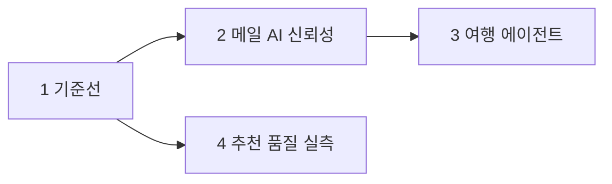
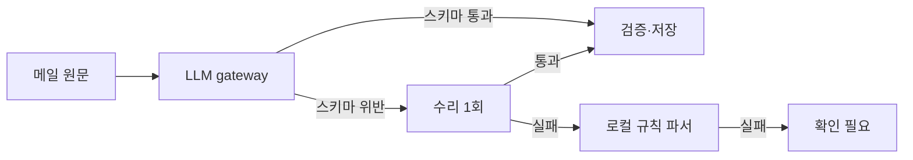

# 고잉 v6 PRD — 증명할 수 있는 메일 AI와 여행 에이전트

> v5까지 만든 기능을 "돌아간다고 말할 수 있는 상태"로 바꾸고, 그 위에 측정 가능한 AI 기능을 올리는 4단계 고도화 계획.

2026-10-20 · 구현 전 기획 · 기준: 로컬 `codex/private-beta-launch` HEAD `5da54dd` + 미커밋 변경 153개(수정 88 · 미추적 65)

**세 줄 요약**

- 기능은 이미 많고, 부족한 것은 증명이다. CI 0개, 로그인 이후 브라우저 E2E 0회, 메일 추출 정답셋 0건, 추천 사람 라벨 0건이며 최신 v5는 GitHub에도 운영에도 없다.
- 순서는 ① 기준선(보존·CI·E2E·일정 결함) → ② 메일 AI 신뢰성(벤더 중립 gateway·프롬프트 버전·정답셋 평가·근거 검증) → ③ 여행 에이전트(tool calling, 미리보기까지만) → ④ 추천·일정 품질 실측 루프다.
- 단계마다 성공 판정 한 줄과 숫자를 남긴다. 합성 수치와 실측 수치를 한 표에 섞지 않고, 설치·유료 호출·push·배포는 사람이 승인한다.

> [!IMPORTANT]
> 이 문서의 목표치는 모두 가설이다. 2절의 근거는 2026-10-20 코드 읽기로 확인했고, **이번 기획에서 테스트·서버·외부 호출은 실행하지 않았다.** 줄 번호는 이 날짜 기준이다.

## 목차

1. 왜 이 방향인가
2. 코드에서 확인한 출발점
3. 목표와 비목표
4. 단계별 범위
5. 핵심 설계 결정
6. 측정 계획
7. 포트폴리오 문장이 어떻게 바뀌는가
8. 위험과 멈춤 지점
9. 검토 후 제외한 안
10. 대표 결정 사항
11. 참고 자료

## 1. 왜 이 방향인가

v6의 목표는 기능 수를 늘리는 것이 아니라 **확인된 범위를 넓히는 것**이다. 근거는 세 가지다.

첫째, 자기소개서 자료의 "아직 성과로 주장할 수 없는 부분"은 대부분 측정 도구가 없어서가 아니라 측정 입력이 없어서 생겼다. 추천 평가기(NDCG·bootstrap·승격 규칙)는 있지만 라벨이 0건이고, 브라우저 fixture는 있지만 로그인 이후 자동 시험이 0회다.

둘째, 관심 영역인 LLM 신뢰성·tool calling·CI의 재료가 이 저장소에 이미 있다. 엄격 JSON schema, 비용 예약·정산 ledger, 응답 영수증 replay, 일정 preview/apply가 그것이다. 새 프로젝트를 시작하는 것보다 여기서 심화하는 비용이 낮고, 면접에서 설명할 맥락도 깊다.

셋째, 기본 배포에서 실제로는 작동하지 않는 경로가 있다. 경로 제공자가 꺼져 있으면 모든 이동 구간이 미확인이 되고, OSM 영업시간은 저장만 되고 판정에 쓰이지 않으며, 비 오는 날 Plan B는 음식점 대부분을 탈락시킨다. "기능이 있다"와 "쓸 수 있다"가 다르다.

4단계는 1단계 뒤 언제든 시작할 수 있다. 사람 라벨에 시간이 들기 때문에 2·3단계와 나란히 진행해도 된다.

## 2. 코드에서 확인한 출발점

아래는 v6가 해결할 공백이다. 2026-10-20 읽기 전용 확인이며 실행 결과가 아니다.

| ID | 확인한 사실 | 근거 위치 | 단계 |
| --- | --- | --- | --- |
| G1 | CI 워크플로 없음. 테스트는 Python 78 · JS 17 파일 | `.github/` 없음, `tests/` | 1 |
| G2 | 로그인 이후 브라우저 E2E 자동화 없음. 수동 fixture 서버뿐 | `scripts/stage1_browser_fixture.py`, `package.json` | 1 |
| G3 | 최신 v5 코드·문서·테스트 다수가 미추적. clone으로 복원 불가 | `git status` 수정 88 · 미추적 65 | 1 |
| G4 | 경로 제공자가 꺼져 있으면 모든 구간이 `ROUTES_DISABLED`. 도보 추정 분기에 도달하지 않음 | `api.py:161-170`, `src/itineraries/travel_time.py:119,168-177` | 1 |
| G5 | Render Free 512MB에서 Lingua(디스크 307MB) 적재 시 메모리 미측정 | v5 `RECOMMENDATION_EVALUATION.md` | 1 |
| G6 | LLM 호출 경로가 OpenAI 형식에 고정. 대체 모델 없음 | `src/reliability/providers.py:291,320`, `src/parser.py:155` | 2 |
| G7 | 프롬프트가 코드 안 문자열. 파이프라인 서명에 프롬프트 hash 없음 | `parser.py:101,372`, `src/rag.py:27`, `src/reliability/handlers.py:189` | 2 |
| G8 | 추출 결과가 스키마를 어기면 수리 없이 문서 실패 | `parser.py:417-502`, `handlers.py:298-320` | 2 |
| G9 | 추출 정답셋·필드 단위 평가 없음. 기존 eval은 legacy 경로 약 20문항 | `examples/mail-test-pack/expected-results.json:4`, `src/evaluate.py` | 2 |
| G10 | v2 답변: top-5 유사도 하한 없음, 생성 후 근거 검사 없음 | `src/foundation/search.py:247,263-278`, `rag.py:36,45` | 2 |
| G11 | 질문 라우팅은 정규식·키워드. tool-calling agent는 legacy CLI 전용이고 비용 계량 밖 | `search.py:184-278`, `src/agent.py:278-290` | 3 |
| G12 | Plan B는 `place_id` 순 12곳만 검토, 비는 `indoor` 태그 필요, 날씨 출처 없음 | `src/travel_tools/alternatives.py:60-65,122` | 3 |
| G13 | 비브라우저 클라이언트용 토큰 인증 없음(쿠키 전용) | `src/foundation/auth.py:87-107` | 3 |
| G14 | 후보 수집은 Photon `restaurant`·`cafe`만. OSM 영업시간은 판정에 쓰지 않음 | `src/discovery/public_places.py:59,86,115`, `src/recommendations/engine.py:158` | 4 |
| G15 | 랭킹이 쓰는 행동 신호는 '관심 없음' ×0.5 하나. 저장·방문은 미사용 | `src/recommendations/service.py:104-105`, `hybrid_v6.py:156-158` | 4 |
| G16 | 평가기는 모든 후보 판정을 요구하고, 60개 작업칸이 비었으며 라벨 수집 도구가 없음 | `benchmark.py:23-47`, `evaluation_v5.py:27-38`, `fixtures/blind-evaluation-plan.json` | 4 |

> [!NOTE]
> G4는 `tests/test_location_providers.py:252`가 "비활성 제공자면 분 단위 값 없음"을 고정하고 있어 의도일 수 있다. 결함인지 정책인지는 10절 결정 1로 정한다.

## 3. 목표와 비목표

각 단계는 아래 한 줄로 통과 여부를 판정한다.

| 단계 | 목표 | 성공 판정 |
| --- | --- | --- |
| 1 | 잃지 않고, 자동으로 확인하고, 실제로 도는지 본다 | `make ci` 한 번으로 Python·JS·PG·자산·게시 안전 검사가 통과하고, 골든패스 E2E 5개가 합성 로그인으로 통과한다 |
| 2 | 메일 AI를 숫자로 관리한다 | 합성 정답셋 30건 이상에서 필드 F1이 나오고, 고의 회귀를 CI가 막고, 근거 없는 날짜·시각·금액 답변이 평가셋에서 0건이다 |
| 3 | 질문을 도구로 푼다 | 시나리오 30개에서 금지 도구 호출·다른 여행 노출·사용자 클릭 없는 적용·주입 성공이 모두 0이다 |
| 4 | 추천 품질을 사람 라벨로 잰다 | 사람이 라벨한 holdout 질의(목표 40, 부족하면 실제 수)로 v5/v6 차이와 95% 구간을 내고 결정을 기록한다 |

하지 않는 것:

- 새 메뉴·폼·토글 추가, 대규모 재디자인, 프런트 프레임워크 전환
- 자동 예약·결제·메시지 발송, 일정 편집을 외부 예약 취소로 처리
- 리뷰 소비자 기능 ON, hybrid_v6 자동 승격
- 유료 인프라·자동 충전·한도 증액
- 합성 수치를 실측 성과로 보고

## 4. 단계별 범위

### 4.1 1단계 — 기준선

로컬에만 있는 v5를 잃지 않게 묶고, 사람이 없어도 매 커밋 검사되게 하고, 로그인 이후 흐름이 실제로 도는지 확인한다.

| 묶음 | 내용 | 완료 증거 |
| --- | --- | --- |
| A 보존 | v5 작업을 의미 단위 로컬 커밋으로 묶음. 발표 파일·비밀·`data/` 제외. 공개 저장소 게시 전 점검 스크립트 | 커밋 계획 문서, 남긴 파일과 이유 |
| B CI | GitHub Actions: Python(SQLite)·JS·자산 hash·PG+pgvector·게시 안전 점검. secret·배포 job 0 | `make ci` 로컬 로그, `ci.yml` |
| C E2E | Playwright로 골든패스·A/B 격리·메일 1건·390px 키보드·늦은 응답 | 시나리오별 통과 로그, 합성 스크린샷 |
| D 결함 | E2E로 드러난 결함과 G4 이동시간 정책 | 결함마다 회귀 테스트 |
| E 출시 준비 | 메모리 측정, 배포 커밋 `d154dc0` 대비 차이, 출시 체크리스트 | 측정표, 체크리스트 |

- 예상 시간: 20~25시간 [추정]
- 승인 필요: Playwright 설치, push, Render 배포
- 공개 저장소이므로 게시 전 점검에 `/Users/<사용자명>/` 절대경로 누출을 포함한다. CLAUDE.md와 인수인계 문서에 이미 있다.

### 4.2 2단계 — 메일 AI 신뢰성

메일 추출과 질문 답변을 "잘 되는 것 같다"에서 "같은 정답셋으로 숫자가 나오고, 나빠지면 CI가 막는다"로 바꾼다.

| 묶음 | 내용 |
| --- | --- |
| A 정답셋 | `mail_gold_v1`: 기존 두 팩 14건 변환 + 신규 합성 16건 이상(일·스·영, 변경·취소, 결제일 혼동, 주입 문구 등) |
| B 평가기 | 필드 P/R/F1, 예약 수 정확도, 확인 필요 재현율, 금지 위반 수, 사례별 비용·지연 |
| C 프롬프트 레지스트리 | `src/prompts/`로 이동, 버전·hash, 새 작업 서명에 포함, 기존 checkpoint 호환 |
| D gateway 어댑터 | OpenAI(현행과 동일)·Replay(키 없이 CI)·Anthropic(선택). 호출부가 `choices[0]`를 직접 읽지 않음 |
| E 수리·폴백 | 스키마 위반 시 수리 1회 → 로컬 파서 → 확인 필요. 기존 예약·교정값 보존 |
| F 근거 검증 답변 | 유사도 하한, 답변 속 날짜·시각·금액·예약번호를 SQL 사실과 대조, 실패 시 구조화 답변으로 대체 |
| G 질문 평가셋 | 40문항 이상: 목록·세부·교정값·답변 불가·다른 여행·주입 |
| H 계측·게이트 | 호출별 지연·토큰·비용·스키마 통과·수리 횟수, replay 평가 CI 게이트 |

LLM 기능 명세(DEV 3번 ④):

| 항목 | 값 |
| --- | --- |
| 모델 | 추출 `gpt-5-mini`(현행). 선택 2순위는 Anthropic 소형 모델, ID·가격은 구현 시점 확인 [미확인] |
| 프롬프트 위치 | `src/prompts/<id>.md`, front matter에 id·version |
| 토큰 상한 | 기존 `max_completion_tokens` 유지, 수리 호출은 별도 상한 |
| 실패 폴백 | 수리 1회 → 로컬 파서 → 확인 필요. 유료→유료 자동 전환은 기본 OFF |

> [!WARNING]
> AI 경로의 첫 replay 기록은 대표가 live 평가를 한 번 실행해야 생긴다. 그 전에는 손으로 만든 정답·오답·스키마 위반 응답으로 **파이프라인만** 시험한다. 그 숫자는 모델 품질이 아니다.

- 예상 시간: 25~30시간 [추정]
- 승인 필요: `anthropic` 패키지 설치(선택), live 평가 실행과 비용 상한

### 4.3 3단계 — 여행 에이전트

정규식 라우터가 답하지 못하는 질문을 기존 서비스 함수를 도구로 쓰는 tool-calling 루프로 처리한다. 에이전트는 읽고, 미리보기를 만들고, 초안을 쓸 수 있지만 적용·삭제·발송은 할 수 없다.

| 도구 | 종류 | 재사용 구현 |
| --- | --- | --- |
| `get_trip_context` | 읽기 | `src/discovery/context.py` |
| `list_bookings` | 읽기 | `repository.list_bookings` 날짜 범위 |
| `search_mail` | 읽기 | v2 검색 + 2단계 근거 검증 |
| `list_saved_places` · `get_place` | 읽기 | 보관함·장소 사실 |
| `get_itinerary` | 읽기 | `src/itineraries/service.py` |
| `preview_itinerary_change` | 미리보기 | 기존 preview, apply 아님 |
| `suggest_plan_b` | 미리보기 | `src/travel_tools/alternatives.py` |
| `get_weather` | 읽기·외부 | Open-Meteo 예보, 도시 좌표만, 캐시 |
| `draft_inquiry` | 초안 | 예약 준비의 문의 초안 |

안전 규칙:

- 사용자·여행 범위는 서버 actor가 정한다. 도구 입력에 user_id를 받지 않는다.
- 단계 5회 · 도구 호출 8회 · 요청 25초 · 질문당 비용 예약 [가설]. 상한 도달 시 부분 답변과 못 한 것.
- 날짜 전체 목록·예약번호 조회는 LLM 없이 기존 빠른 경로. AI OFF·예산 소진이면 기존 라우터와 같은 결과.
- 메일 본문·도구 결과는 신뢰할 수 없는 데이터로 다룬다. apply·undo·delete·외부 메시지·임의 URL fetch 도구는 레지스트리에 없다.
- 미리보기 적용은 사용자가 카드의 '적용'을 눌러 기존 apply API로만 한다.

Plan B 개선도 이 단계에 넣는다. `place_id` 정렬을 점수·거리 순으로 바꾸고, 음식점·카페는 범주 기반 `indoor_likely`(미검증)로 별도 표시하며, 날씨는 제안의 계기로만 쓴다.

선택 묶음 MCP(결정 3): 해시 저장·만료 30일·폐기 가능한 개인 접근 토큰, 읽기 GET과 질문에만 Bearer 허용, 로컬 stdio MCP 서버. 운영 기본 `PERSONAL_TOKENS_ENABLED=0`.

- 예상 시간: 25~35시간 [추정], MCP 포함 시 +8~10시간
- 승인 필요: `mcp` 패키지 설치(선택), live 시나리오 실행, 날씨 외부 호출 기본값

### 4.4 4단계 — 추천·일정 품질 실측

산출물은 새 모델이 아니라 **사람 라벨로 v5와 v6를 비교한 결과와 결정 기록**이다. '차이 없음'도 정상적인 결과다.

| 묶음 | 내용 |
| --- | --- |
| A 무료 후보 보강 | Photon 관광 계열 태그로 '볼거리'를 `reference` 자격으로만 추가. OSM `opening_hours` 부분집합 파서 → provisional 사실 |
| B 라벨 도구 | 관리자 전용, 블라인드(점수·순위·모델명 비노출), pooled 판정, 단축키, 진행률 |
| C 평가·결정 | 같은 frozen snapshot으로 v5/v6, 60/200 pool 비교. 기존 승격 규칙 그대로 |
| D 피드백 루프 | '이번 여행에서 덜 보기', 저장한 장소 기반 여행 범위 취향(기본 OFF), 저장한 곳 가까운 순서 |
| E 리뷰 파일럿(선택·유료) | 기존 계획 스크립트로 준비만. 원격 run은 대표가 상한을 정하고 실행 |

라벨 부담 계산: 질의 40개 × pooled 후보 약 15곳 = 판정 600개. 판정당 15~25초로 잡으면 약 2.5~4시간이다 [추정]. 지금 평가기처럼 모든 후보(최대 200)를 판정하게 하면 현실적으로 끝나지 않으므로 pooled 모드를 추가한다(5절 D5).

- 예상 시간: 25~35시간 + 대표 라벨 2.5~4시간 [추정]
- 승인 필요: 운영 DB 읽기 전용 범위 확인 실행, 유료 리뷰 파일럿

## 5. 핵심 설계 결정

각 결정은 이유와 버린 대안을 함께 적는다. 대표가 사후에 뒤집을 수 있게 하기 위해서다.

| ID | 결정 | 이유 | 버린 대안 |
| --- | --- | --- | --- |
| D1 | 기존 `ProviderGateway` 안에 어댑터 층을 만든다 | 예약·정산·영수증 replay·재시도 계약이 gateway에 있다 | LangChain으로 교체 — 계량 밖 경로가 생김(legacy agent가 그 예) |
| D2 | 에이전트 쓰기는 미리보기까지 | 고정 예약 보호와 409 재검증이 apply에 있다. 사람 확인 지점을 유지 | 에이전트 직접 적용 — 되돌리기는 있어도 확인 없는 변경 |
| D3 | CI 평가는 replay만, live는 수동·상한 필수 | 공개 저장소 CI에 키를 두지 않고 비용 0 유지 | CI에서 live 호출 — secret 노출·비용 위험 |
| D4 | 이동시간: 제공자 비활성 시 3km 이하 도보만 추정, 잠정안에서만 사용(10절 결정 1 = A) | strict 판정의 정직성을 유지하면서 기본 배포의 일정 기능을 살림 | 현행 유지 / strict에서도 추정 허용 |
| D5 | 평가에 pooled 판정 모드 추가, `judged@5` 커버리지 병기 | 1인 라벨러가 끝낼 수 있는 분량 | 전체 후보 판정 — 질의당 최대 200 판정 |
| D6 | MCP는 로컬 stdio, 운영 토큰 기본 OFF | 인증 표면을 늘리되 공개 서비스 위험은 막음 | 원격 MCP 서버 — OAuth·호스팅 범위가 커짐 |

## 6. 측정 계획

합성과 실측을 열로 분리해 기록한다. 분모가 0이면 미측정이다.

| 지표 | 정의 | 자료 | 단계 |
| --- | --- | --- | --- |
| CI 통과 | 커밋별 워크플로 결과 | Actions | 1 |
| 골든패스 E2E | E01~E05 통과 수 | 합성 fixture | 1 |
| 기동·작업 후 RSS | 기동 직후·추천·메일 분석 뒤 | 로컬, 512MB 가정 | 1 |
| 추출 필드 F1 | 매칭된 예약의 필드 단위 F1, local/replay/live | 합성 정답셋 | 2 |
| 금지 위반 | 결제일을 방문일로, 변경을 신규 확정으로 등 | 합성 정답셋 | 2 |
| 근거 없는 원자 | 답변 속 날짜·시각·금액·예약번호 중 사실에 없는 수 | 합성 질문셋 | 2 |
| 거절 정밀도·재현율 | 답변 불가 문항 기준, `grounding` 필드로 판정 | 합성 질문셋 | 2 |
| 호출 지연·비용 | LLM 호출별 p50/p95, 건당 비용 | 계측 테이블 | 2 |
| 에이전트 안전 | 금지 도구·노출·주입·무단 적용 수 | 합성 시나리오 | 3 |
| 과업 성공률 | 기대 결과를 만든 시나리오 비율 | live만 의미 있음 | 3 |
| NDCG@5 · Precision@5 | gain 2^label−1, 분모 5, 질의 쌍 bootstrap | 사람 라벨 | 4 |
| 영업시간 파싱률 | 파싱 성공 / OSM 표기 보유 지점 | 공개 지도 | 4 |
| 저장률 · 일정 채택률 | 기존 v5 정의, 동의 사용자 이벤트만 | 실사용 | 4 |

## 7. 포트폴리오 문장이 어떻게 바뀌는가

첨부 자료 15.2절의 "주장할 수 없는 부분"을 단계 완료 후 쓸 수 있는 문장으로 바꾼다. 오른쪽 문장은 결과가 나왔을 때만 쓴다.

| 지금 쓰면 안 되는 표현 | 완료 후 쓸 수 있는 표현 | 단계 |
| --- | --- | --- |
| 모든 화면을 검증했다 | 골든패스 E2E 5개를 CI에서 매 커밋 실행한다 | 1 |
| 메일 추출 정확도 100% | 합성 정답셋 N건에서 필드 F1 x, 실패 유형별 분포를 관리한다 | 2 |
| 환각이 없다 | 근거 없는 날짜·시각·금액을 검사해 구조화 답변으로 대체하고, 평가셋에서 0건 | 2 |
| LLM 벤더를 바꿀 수 있다 | 같은 정답셋으로 OpenAI·Replay(·Anthropic) 어댑터를 비교했다 | 2 |
| AI 에이전트를 만들었다 | 미리보기까지만 쓰는 tool-calling 에이전트, 금지 도구 호출 0/30 | 3 |
| 추천 정확도를 개선했다 | 사람 라벨 holdout N개에서 v5 대비 v6 NDCG@5 차이 x(95% 구간 a~b) | 4 |

## 8. 위험과 멈춤 지점

구현 세션이 반드시 멈추고 사람에게 넘기는 지점:

1. 패키지 설치 — Playwright, `anthropic`, `mcp`, `typescript`. 이름·버전·이유를 목록으로 제시
2. 유료 외부 호출 — OpenAI live 평가, Apify, Google 경로·장소
3. 운영 DB 읽기 — 비밀 설정이 필요하므로 명령만 넘김
4. push · PR · Render 배포 · 운영 플래그 변경
5. 10절 결정이 비어 있는 항목

알려진 위험:

- gateway 어댑터화가 기존 1,264개 Python 시험의 가정을 깰 수 있다. OpenAI 어댑터는 kwargs까지 현행과 같아야 하며, 기존 전체 시험 통과가 기준이다.
- 프롬프트 hash를 서명에 넣으면 진행 중 작업이 `CHECKPOINT_INCOMPATIBLE`이 될 수 있다. 서명 버전 필드로 기존 checkpoint를 구분한다.
- Open-Meteo는 공유 IP 호스트(Render 포함)에서 한도에 먼저 걸릴 수 있다고 안내한다. 도시·날짜 캐시와 실패=미확인 처리로 대응한다.
- 라벨러가 대표 1명이라 판단 편향이 있다. 보고서 한계에 명시한다.
- Desktop 하위 작업 폴더에서 파일 시스템 응답이 느렸다(기획 중 명령 2회 시간 초과). 원인은 미조사다.

## 9. 검토 후 제외한 안

| 안 | 제외 사유 | 다시 볼 조건 |
| --- | --- | --- |
| Gmail 자동 연동 | `gmail.readonly`는 restricted scope이고 서버 저장 시 연 1회 보안 평가가 필요하다. Testing 상태는 100명·refresh token 7일 만료 | 1인 사용으로 한정하고 주 1회 재동의를 감수할 때 |
| 지도 화면(Leaflet 등) | 차별점과 무관, 프런트 의존성 추가, 타일 이용 정책 미조사 | 일정 화면에서 지도 링크 사용이 반복 관측될 때 |
| OSRM 공개 demo 경로 | 가벼운 사용만 허용, 운영 의존 불가 | 자체 호스팅 서버가 생길 때 |
| 동행자 공유·공동 편집 | 소유권 모델 전면 변경, v5에서도 후순위 | 실제 동행 사용 요청이 생길 때 |
| 다도시 일정 | `STOP_BOUNDARY_UNSUPPORTED` 해소는 scheduler 전반 변경 | 4단계 이후 v7 |
| 프런트 TypeScript 전환 | 약 2,700줄 vanilla JS 전환 비용이 이득보다 큼 | 1단계 선택 과제 `// @ts-check` + `tsc --noEmit`으로 대체 |

## 10. 대표 결정 사항

구현 프롬프트는 이 절을 읽는다. 비어 있으면 해당 항목에서 멈춘다.

1. **일정 이동시간 기본 정책(1단계)** — A(권장): 제공자 비활성 시 같은 도시 3km 이하 도보만 `estimate`로 계산하고 잠정안에서만 사용, strict는 현행. B: strict도 추정 허용. C: 현행 유지.
   결정: **A** — 제공자 비활성 시 같은 도시 3km 이하 도보만 `estimate`로 계산, 잠정안에서만 사용, strict는 현행 (2026-10-20 대표)
2. **Anthropic 어댑터(2단계)** — A(권장): 인터페이스·가짜 응답 시험까지, 실제 키 호출은 대표가 키와 상한을 정한 뒤. B: OpenAI만.
   결정: **A** — 인터페이스·가짜 응답 시험까지, 실제 키 호출은 대표가 키와 상한을 정한 뒤 (2026-10-20 대표)
3. **MCP 묶음(3단계)** — A(권장): 포함, 로컬 전용, 운영 토큰 기본 OFF. B: 제외.
   결정: **A** — 포함, 로컬 전용, 운영 `PERSONAL_TOKENS_ENABLED=0` (2026-10-20 대표)
4. **날씨 외부 호출 기본값(3단계)** — A(권장): 개발 ON / 운영 OFF로 시작, 이용 조건 재확인 후 운영 ON. B: 모두 OFF.
   결정: **A** — 개발 ON / 운영 OFF로 시작, 이용 조건 재확인 후 운영 ON (2026-10-20 대표)
5. **라벨 시간(4단계)** — 대표가 약 2.5~4시간 직접 라벨. 불가하면 4단계는 도구까지만 하고 측정은 미측정으로 둔다.
   결정: **직접 라벨** — 대표가 약 2.5~4시간 투입 (2026-10-20 대표)

## 11. 참고 자료

외부 자료는 2026-10-20 검색으로 확인했다. 구현 직전에 다시 확인한다.

- [GitHub Actions 요금](https://docs.github.com/en/billing/reference/actions-runner-pricing) — 공개 저장소 standard runner 무료
- [Gmail API scope 분류](https://developers.google.com/workspace/gmail/api/auth/scopes) · [Restricted scope 검증](https://developers.google.com/identity/protocols/oauth2/production-readiness/restricted-scope-verification)
- [OAuth 앱 Testing 상태와 토큰 만료](https://developers.google.com/identity/protocols/oauth2) · [App audience 관리](https://support.google.com/cloud/answer/15549945?hl=en)
- [Render Free 사양](https://render.com/docs/compute-plans) · [Render FAQ — 15분 유휴 중지](https://render.com/docs/faq)
- [Open-Meteo 이용 조건](https://open-meteo.com/en/terms) — 비상업, 일 10,000회 미만, CC BY 4.0 표기
- [OSRM API 이용 정책](https://github.com/Project-OSRM/osrm-backend/wiki/API%20Usage%20Policy)

저장소 안 문서:

- [v5 PRD](../service-v5/PRD.md) · [v5 진행 기록](../service-v5/IMPLEMENTATION_STATUS.md) · [추천·언어 평가](../service-v5/reports/RECOMMENDATION_EVALUATION.md) · [자료 범위](../service-v5/reports/DATA_COVERAGE.md)
- [인수인계](../handoff/PROJECT_HANDOFF_2026-10-08.md)
- 단계별 구현 프롬프트: [1 기준선](prompts/01-baseline-ci-e2e.md) · [2 메일 AI 신뢰성](prompts/02-mail-ai-reliability.md) · [3 여행 에이전트](prompts/03-trip-agent.md) · [4 추천 품질 실측](prompts/04-recommendation-eval-loop.md)
