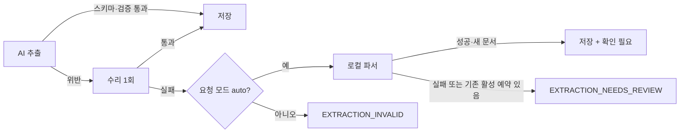

# 2단계 보고서 — 메일 AI 신뢰성: 정답셋 · 벤더 중립 gateway · 근거 검증

> v6 2단계 프롬프트(`prompts/02-mail-ai-reliability.md`)를 실행한 기록. 정답셋 구성, local·replay 결과(모두 synthetic), live 미실행, 바뀐 계약과 이유, 대표에게 넘길 일을 담는다.

2026-10-21 · Claude Code 세션 · **이 보고서 작성 시점(2026-10-21) 미커밋(작업 트리에만 있음, HEAD 5a4443a 그대로)** · 같은 날 로컬 커밋 5개로 나눔(코드 4 + 문서 1, push 없음 — 목록은 IMPLEMENTATION_STATUS 「커밋」 절) · push·배포·live 유료 호출 없음 · PRD 10절 결정 2 = A(Anthropic은 인터페이스·가짜 응답 시험까지)

**세 줄 요약**

- 합성 정답셋 `mail_gold_v1` 35건(예약 45개)을 만들고 평가기를 붙였다. 규칙 파서(local) 기준선은 필드 micro F1 **0.802** · 예약 수 정확도 0.857 · forbidden 위반 **0**이다(synthetic). 단 forbidden 0 은 사례별 forbidden 항목 14개 중 측정 가능한 12개 기준이다 — 규칙 파서는 amount·currency·deposit 를 내지 않아 `deposit_as_total` 2건(mtp-03, syn-17)은 측정 불가다.
- OpenAI 고정 호출을 어댑터(OpenAI · Replay · Anthropic) 뒤로 옮겼다. OpenAI 경로의 요청 kwargs·`request_hash`·`call_key`·영수증은 변경 전과 바이트까지 같다(골든 시험). 스키마 위반은 수리 1회 → auto 모드 로컬 파서 → 확인 필요 순으로 넘기고, 기존 활성 예약·교정값은 어떤 실패에도 지우지 않는다.
- 답변 속 날짜·시각·금액·예약번호·인원을 SQL 사실과 대조해 근거가 없으면 구조화 답변으로 바꾼다. 질문 평가셋 53문항에서 근거 없는 원자 0·다른 여행 노출 0이고, `make ci-eval` 게이트는 고의 회귀에서 실패했다(synthetic).

> [!IMPORTANT]
> 이 문서의 모든 평가 숫자는 합성 정답셋과 손으로 만든 replay 응답 기준이다. **replay 숫자는 파이프라인 시험이지 모델 품질이 아니다.** 실제 모델 품질은 대표가 live 평가를 실행해야 나온다.

## 출발점

| 항목 | 값 |
| --- | --- |
| HEAD · 브랜치 | `5a4443a` · `codex/private-beta-launch`, 작업 트리 깨끗 |
| 기준 시험 | `make ci-python` 1302 통과 · 25 skip · 실패 0 (3분 42초, 변경 전) |
| Python | `~/.venvs/travel-inbox-rag/bin/python` (저장소 `.venv`는 iCloud 대기로 사용 안 함) |
| iCloud | 시작 시 src·tests 등 dataless 512개 + `.git` → `brctl download`로 모두 받은 뒤 시작 |
| Docker | 대표가 꺼 둠 → PostgreSQL 시험은 전부 미실행 |

조사는 읽기 전용 워크플로 5개로 먼저 했다(계측 시험, DB 스키마·운영 요약, 답변 경로, 작업 체크포인트, legacy·게시 점검). 결과는 구현 계약으로 그대로 썼다.

## 바꾼 파일

| 묶음 | 파일 |
| --- | --- |
| A 정답셋 | `evals/mail/gold/*.json` 35 · `evals/mail/cases/*.eml` 19 · `src/evals/gold.py` · `evals/mail/README.md` |
| B 평가기 | `src/evals/mail.py` · `src/evals/replay_build.py` · `evals/replay/mail/*.json` 37 |
| C 프롬프트 | `src/prompts/__init__.py` · `src/prompts/{mail_document_extraction,mail_single_extraction,trip_answer,mail_extraction_repair}.md` · `src/parser.py` · `src/rag.py` · `src/reliability/handlers.py`(서명) |
| D gateway | `src/llm/{__init__,gateway,openai_adapter,replay,anthropic_adapter,messages,telemetry}.py` · `src/reliability/providers.py` · `src/embedder.py` |
| E 수리·폴백 | `src/parser.py`(수리) · `src/reliability/handlers.py`(폴백·보존) · `src/foundation/local_mail.py`(취소 인식) |
| F 근거 검증 | `src/foundation/grounding.py` · `src/foundation/search.py` · `src/config.py`(`ANSWER_MIN_SIMILARITY`) |
| G 질문셋 | `src/evals/qa.py` · `evals/qa/{fixture.json,questions.json,README.md}` · `evals/replay/qa/*.json` 21 |
| H 계측·게이트 | `src/reliability/llm_schema.py` · `src/foundation/db.py` · `src/storage/postgres.py` · `src/operations/health.py` · `src/evals/gate.py` · `evals/thresholds.json` · `Makefile`(`ci-eval`) · `.github/workflows/ci.yml`(eval job) |
| D6 legacy | `src/foundation/dates.py`(LLM 없는 날짜 파서 이동) · `src/agent.py`(재노출, CLI 전용 표시) · `src/evaluate.py`(legacy 표시 한 줄) |
| 시험 | `tests/test_v6_{prompts,llm_gateway,extraction_repair,extraction_fallback,grounding,eval_mail,eval_gate,eval_qa,admin_llm_ops}.py` · (최종 리뷰 후) `tests/test_v6_report_headers.py` |

## 묶음 A — 정답셋 35건

기존 두 팩은 전부 변환했다. 프롬프트는 "14건"이라 했지만 실제 메일 파일은 16개(mail-test-pack 12 = 01~10 + same-name-a/b, mail-time-pack 4)라 16개를 모두 옮겼다. 원래 `expected-results.json`은 수정하지 않았다.

| 구분 | 수 |
| --- | ---: |
| 사례 / 정답 예약 | 35 / 45 |
| 변환 / 신규 합성 | 16 / 19 |
| 언어 en · ja · es · ko · mixed | 18 · 7 · 7 · 2 · 1 |
| 주요 태그 | 식당 13 · 투어 13 · 숙소 7 · 통화 기호만 4 · 다중 예약 4 · 결제일 4 · 취소 2 · 변경 요청 2 · 자정 넘김 2 · Fwd 2 · HTML 전용 2 · 주입 문구 2 · AM/PM 2 |

- 사례마다 `expected_bookings[]`(type · provider_name · start/end_local · tz · party · amount · currency · deposit · confirmation_code · status), `must_review[]`, `forbidden[]`와 기계 판정용 `decoys`를 둔다.
- **null 구분**: 예약 객체의 `unscored`에 있는 필드는 채점하지 않고, 그 밖의 `null`은 "추출하지 않아야 정답"이다.
- 왕복 항공은 구간마다 정답 예약 하나로 적고, 평가기는 예측도 구간 단위로 펼친다.
- 신규 원문은 `example.com` 도메인, `TEST-…` 예약번호, `Demo …` 업체명만 쓴다. 작성 3명 · 원문 대조 검수 3명 · 수정 3명 워크플로로 만들었다.

## 묶음 B — 평가기

`python -m src.evals.mail --mode local|replay|live --out <path>`가 기계용 JSON과 같은 이름의 `.md`를 쓴다. 예측과 정답은 유형·시작일 기준으로 최적 매칭하고, 남는 예측은 false positive 예약으로 센다. 금액은 Decimal로 정규화해 비교한다.

| 지표 (synthetic) | local 규칙 파서 | replay (파이프라인 시험) |
| --- | ---: | ---: |
| 필드 micro F1 | 0.8018 | 0.761 |
| 예약 수 정확도 | 0.8571 | 0.9714 |
| must_review 재현율 | 0.8333 | 0.0 (측정 가능 3건 중 0건 충족, 그와 별도로 측정 불가 3) |
| forbidden 위반 | 0 (측정 불가 2: `deposit_as_total` mtp-03·syn-17) | 2 (일부러 넣은 결함, 측정 불가 4) |
| 추출기 오류 사례 | 5 (`LOCAL_EXTRACTION_UNSUPPORTED`) | 1 (일부러 넣은 수리 실패) |
| 외부 호출 · 비용 | 0 · 0 | 0 · 0원(replay 가격 0, 원장 37건 settled) |

- local은 `parse_local_document`를 직접 돈다. 처음 기준선은 forbidden 2건(`cancelled_as_active`)이었는데, 규칙 파서가 "reservation **below** has been CANCELLED"와 "キャンセル**いたしました** · ステータス：キャンセル済み"를 못 읽은 것이다. 취소 문구 인식을 좁게 보강해 0건이 됐고, 다른 합성 메일 오탐은 0이었다.
- replay는 임시 SQLite + 평가용 사용자·여행 + 실제 `Budget`·`ProviderGateway`·`metered_context` + `ReplayAdapter`로 실제 parser 경로(수리 포함)를 탄다. 기록은 정답에서 만든 oracle 31개(`gold_oracle`)와 결함 6개(`handmade_fault`: 스키마 위반→수리 성공, 수리 실패, 결제일을 방문일로, 변경 요청을 확정 시각으로 등)다.
- AI 추출 스키마에는 status·인원·금액·식당 종류가 없다. 그래서 replay에서 이 필드의 F1은 구조적으로 0이고, 이 필드에 걸린 must_review 3건(status 2 · party.adults 1)과 forbidden 4건은 측정 불가로 따로 센다(다음 단계 후보).
- **replay known gap 두 가지** — 기준을 느슨하게 둔 허용치가 아니라 심어 둔 결함·구조적 한계를 그대로 적은 값이다(`evals/thresholds.json` `mail_replay.note`).
  - must_review 재현율 0.0은 측정 가능한 `start_local` 3건(mtp-08 · mtp-10 · syn-13)이 모두 미충족(0/3)인 값이다. 충족 조건은 예측 시각이 null이거나, 날짜만 남았거나, review_reasons가 그 필드를 덮는 것이다. mtp-08 · mtp-10의 `gold_oracle` 기록은 정답 시각(13:30 · 02:30)을 그대로 내고 review_reasons도 없어 구조상 충족될 수 없다. syn-13은 변경 요청 시각을 확정 시각으로 쓴 심어 둔 결함(`handmade_fault`)이라 미충족이 맞다. 그래서 이 기준선은 더 떨어질 수 없어 지금 replay에서 회귀를 막지 못한다.
  - forbidden 위반 2는 심어 둔 결함 syn-01 `payment_date_as_visit` · syn-13 `change_as_new_confirmed`이다. 개수는 `max` 2로, 사례·규칙은 `expected_failures`(exact)로 양방향 고정한다.

## 묶음 C — 프롬프트 레지스트리

추출·답변 프롬프트를 `src/prompts/<id>.md`(front matter: id · version · purpose · output_schema · variables)로 옮겼다. 본문은 front matter 뒤를 바이트 그대로 쓰고 로더가 sha256을 계산한다.

| id | 원래 위치 | sha256 앞 12자 |
| --- | --- | --- |
| `mail_document_extraction` | `parser.DOCUMENT_SYSTEM_PROMPT` | `c3cb4036dc53` |
| `mail_single_extraction` | `parser.SYSTEM_PROMPT` | `b43b3cc6cee5` |
| `trip_answer` | `rag.SYSTEM_PROMPT`(`{{NO_INFO_MESSAGE}}`만 변수) | 렌더 결과 `72a2a27491ae` |
| `mail_extraction_repair` | 신규 | — |

- 옮기기 전 원래 문자열의 sha256을 시험에 박아 같은 문자열이 로드되는지 고정했다(`test_v6_prompts.py`).
- AI 모드 `pipeline_signature`는 v2(`signature_version: 2` + 프롬프트 meta 2개 + 추출 체인)다. local 모드 서명은 이전 값 그대로다.
- **진행 중 작업 호환**: v1 서명 체크포인트는 추출 체인이 `openai`이고 레지스트리 문서 프롬프트 hash가 원래 값일 때만 재개를 허용한다. 실제 jobs 경로로 재개해 `CHECKPOINT_INCOMPATIBLE`이 나지 않고 추출 호출 0회임을 시험했다.
- 추출 결과 항목에 `extraction.prompt`, 답변에 `prompt`(id · version · hash), `llm_calls`에 prompt id · version · hash를 남긴다.

## 묶음 D — 벤더 중립 gateway

`ProviderGateway`의 예약·정산·영수증 replay·재시도 계약은 그대로 두고, OpenAI 고정 부분만 어댑터로 뺐다. 호출부(parser · rag · embedder)는 `src/llm/gateway.chat/embed`를 부르고 정규화 결과(`ChatResult`, `EmbedResult`)만 받는다. `choices[0].message.content`를 직접 읽는 호출부는 없다.

| 어댑터 | 상태 |
| --- | --- |
| `openai` | 요청 kwargs · cost bound · estimate · `request_hash` · `call_key`(`<prefix>:<kind>:<n>`) · 영수증 value(`model_dump`) · 예외 매핑이 HEAD와 같음. HEAD 코드를 불러와 같은 입력으로 비교했고, 해시 전체를 골든 시험에 고정 |
| `replay` | 요청 키(메시지 + 출력 schema + 도구 이름, 모델·토큰 상한 제외) → 기록. 키 없이 CI에서 동작. 기록의 요청 메시지는 hash만 남지만, 응답에는 `raw_snippet`(메일 원문 한 줄)이 그대로 남는다(합성 기록 37개 중 35개). 미스는 예약 전에 `REPLAY_MISS` |
| `anthropic` | 인터페이스와 가짜 클라이언트 시험까지. SDK 미설치(`PROVIDER_SDK_MISSING`), 가격 파일에 항목이 없어 호출 전 `BUDGET_NOT_CONFIGURED`, 임베딩 미지원 |

- 체인 설정 `MAIL_EXTRACTION_CHAIN`·`ANSWER_PROVIDER`·`EMBEDDING_PROVIDER`·`AGENT_PROVIDER`의 기본값은 모두 `openai`라 지금 동작과 같다. 유료→유료 자동 전환(`LLM_PAID_FALLBACK`)은 기본 OFF이고, 런타임 전환 자체는 아직 구현하지 않았다(첫 공급자만 씀).
- Anthropic 요청 형태(`output_config.format` json_schema, `stop_reason`, `usage.input_tokens/output_tokens`), 소형 모델 후보 `claude-haiku-5-5`와 가격 $0.10/$0.50 per 1M은 claude-api 참고 자료(2026-10-06 캐시) 기준이라 **[미확인]**이다.
- **D6 legacy agent**: `src/agent.py`의 LangChain LLM 경로는 API·dispatcher에서 호출되지 않는다(`make ask` CLI 전용, docstring에 표시). 다만 운영 경로가 날짜 파서 하나 때문에 이 모듈을 import해 첫 `/ask`에서 LangChain을 불러왔다. 날짜 파서를 `src/foundation/dates.py`로 옮겨 이제 로드하지 않는다(시험으로 고정).

## 묶음 E — 수리와 폴백



- 수리 호출은 검증 오류 목록(원문 없음)과 직전 출력을 붙여 한 번만 보낸다. 별도 `call_key`(`<prefix>:repair:chat:0`), 별도 출력 상한(`MAIL_REPAIR_MAX_COMPLETION_TOKENS`, 기본 4096), 별도 비용 예약을 거친다. length·refusal은 같은 상한으로 다시 잘릴 것이라 수리하지 않는다.
- 과금·전송 오류(`CALL_OUTCOME_UNKNOWN`, 예산 소진 등)는 폴백하지 않아 기존 재시도 차단 계약을 지킨다. 주입 parser(시험·오프라인) 경로도 폴백하지 않는다.
- **보존 계약**: 재처리에서 AI가 실패하고 로컬 파서가 성공해도, 기존 활성 예약이 있으면 활성화하지 않고 `EXTRACTION_NEEDS_REVIEW`로 보낸다. 검수에서 이 경우 AI 필드(refund_policy)가 지워지는 결함을 찾아 고쳤고, "AI 정상 추출 → 교정 → AI 실패와 로컬 성공" 회귀 시험을 붙였다.
- 수리 횟수와 폴백 경로는 결과 항목 `extraction.{repair_attempts, fallback_path}`와 `llm_calls`에 남는다.

## 묶음 F — 근거를 검증하는 답변

- **유사도 하한** `ANSWER_MIN_SIMILARITY` 기본 0.20. 하한 미만 hit만 남으면 생성하지 않고 "메일에서 확인하지 못했어요"와 다음 행동(메일 올리기, 날짜로 묻기)을 보여 준다. 수동 입력 예약은 기존 계약대로 하한과 무관하게 근거에 남는다.
- 0.20은 legacy 측정값을 사전값으로 쓴 것이다. 묶음 G의 하한 비교는 결정적 해시 임베더 기준이라 실제 `text-embedding-3-small` 값을 정할 수 없다. live 평가가 의미검색 1위 유사도를 기록하도록 해 두었다.

| 하한 (synthetic 해시 임베더) | 거절 정밀도 | 거절 재현율 |
| --- | ---: | ---: |
| 0.1 | 1.0000 | 0.6111 |
| 0.3 | 0.7391 | 0.9444 |

- **검증기** `src/foundation/grounding.py`: 답변에서 날짜(ISO · M월 D일 · 영어 월) · 시각(HH:MM · 오전/오후 · PM) · 금액+통화(기호·코드·엔/유로) · 예약번호 · 인원을 뽑아, 이번 응답에 넘긴 facts(교정 반영 SQL 값)에 있는지 본다. 하나라도 없으면 `_structured_answer`로 대체(`grounding=fallback`), 모두 있으면 `verified`, 생성하지 않은 분기는 `refused`·`structured`·`clarify`.
- 모델이 쓴 `출처:` 줄은 화면에서 지우고 검증에서도 뺀다. 출처는 코드가 `sources`로 붙인다.
- facts에는 effective 값만 들어가므로, 교정 전 원래 값을 말한 답변은 fallback이 된다(시험으로 고정).
- 인원 질문은 facts에 인원이 없어 근거 확인이 불가능하므로 생성 없이 SQL로 답한다.

## 묶음 G — 질문 평가셋 53문항

합성 fixture(도쿄 여행 A, 마드리드 여행 B, 다른 사용자 C의 여행, 교정값, refund_policy 속 주입 문구)에 53문항을 둔다: 세부 조건 11 · 다른 여행 10 · 답변 불가 10 · 대명사 6 · 날짜 목록 6 · 교정값 5 · 주입 5. 거절은 키워드가 아니라 `grounding`과 `answer_type` 필드로 판정한다.

| 지표 (synthetic) | local 기본 분석 | replay AI 경로 |
| --- | ---: | ---: |
| 답변 가능 정답률 | 1.0 | 0.9032 |
| 거절 정밀도 | 1.0 | 0.8696 |
| 거절 재현율 | 0.45 | 1.0 |
| 근거 없는 원자 | 0 | 0 |
| 다른 여행 노출 | 0 | 0 |

- replay는 결정적 해시 임베더 + 손으로 만든 답 기록 21개(정답과 일부러 근거 없는 시각·금액을 넣은 오답)로 돈다. 오답은 검증기가 fallback으로 바꿨다.
- 근거 없는 원자 0은 운영 검증기와 같은 추출기로 센 값이라 독립 측정이 아니다.
- `src/evaluate.py`는 지우지 않고 "legacy 평가(legacy rag 경로, 외부 호출 필요)"로 표시했다.

## 묶음 H — 계측과 CI 게이트

- `llm_calls` 테이블에 provider · model · operation · prompt id/version/hash · latency_ms · 입출력 토큰 · 비용 · schema_valid · repair_attempts · outcome · replayed를 저장하고, `usage_reservations.call_id`로 원장과 연결한다. 메일·질문·응답 원문은 저장하지 않는다.
- 테이블은 스키마 버전을 올리지 않고 매 기동 `CREATE TABLE IF NOT EXISTS`로 만든다(SQLite는 버전 마이그레이션 뒤, PG는 `CLOUD_SCHEMA` 뒤). 숫자 15를 박은 마이그레이션 시험·스냅샷 가져오기·다운그레이드 재현 시험을 건드리지 않기 위해서다.
- 관리자 운영 요약 `/api/v2/admin/operations`의 `observations.llm_calls`에 provider·model·operation별 p50/p95·실패율·스키마 통과율·수리 수·비용을 더했다. `calls`는 실제로 보낸 호출만 세고, 영수증 재생(`replayed`)과 전송 전 차단(`blocked`)은 따로 센다.
- `evals/thresholds.json`에 mail·qa의 local·replay 기준선을 두고 `python -m src.evals.gate`가 판정한다: 지표가 기준선보다 0.02 넘게 떨어지거나, forbidden 위반·근거 없는 원자·다른 여행 노출이 허용치를 넘으면 실패. local 의 forbidden·근거 없는 원자·다른 여행 노출 허용치는 0이다(그 밖에 mail_local 추출기 오류 5, qa injection_text_relays 1 은 알려진 기준선으로 허용. 측정 불가 2건은 `expected_failures.forbidden_unmeasurable` 로 양방향 고정). replay의 forbidden 허용치 2는 일부러 넣은 결함 수다. 정답셋 범위는 사례 수·case_id hash 에 더해 내용 hash(`gold_sha256`, qa 는 `questions_sha256`·`fixture_sha256`)로 고정해, 같은 id 로 정답을 약하게 고치면 실패한다. qa_local·qa_replay·agent_replay 는 `required: true` 라 결과를 빼면 실패한다.
- `make ci-eval`(local·replay 평가 → gate)과 `ci.yml`의 `eval` job을 추가했다. secret 0 · 유료 호출 0.
- **고의 회귀**: oracle 기록에 예약을 하나 더 넣자 `booking_count_accuracy 0.9429 < 기준선 0.9714 - 0.02`와 `forbidden_violations 3 > 허용 2`로 exit 1이 났다(복사본만 망가뜨려 되돌릴 것 없음). 같은 경우를 `test_v6_eval_gate.py`로 고정했다(2026-10-21 collect 22개 — 최종 리뷰 후 다시 셈, EVAL-2·EVAL-4 시험 포함. 최종 `make ci-python` 1890 통과에 들어 있다).

## 완료 기준

| ID | 판정 | 근거 |
| --- | --- | --- |
| S2-01 | 달성 | 35건, 모두 `synthetic: true`, 두 팩 16건 전부 변환 |
| S2-02 | 달성 | local F1 0.8018 · 예약 수 정확도 0.8571 · forbidden 0(측정 가능한 12개 항목 기준, `deposit_as_total` 2건 측정 불가) |
| S2-03 | 달성 | 바이트 동일 시험, v1 체크포인트 재개 시험 |
| S2-04 | 달성(최종 재실행) | OpenAI·parser 골든 통과, replay는 키 없이 `ci-eval` 통과. 최종 리뷰 후 전체 시험 `make ci-python` 1890 통과 · 30 skip · 0 실패, `make ci-eval` gate pass(synthetic) — 「최종 리뷰와 최종 재실행」 |
| S2-05 | 달성 | 수리 13개 · 폴백 10개 시험, 기존 예약·교정값·AI 필드 보존 |
| S2-06 | 달성(조건부) | 53문항 local·replay 근거 없는 원자 0, 다른 여행 노출 0 (같은 추출기로 측정) |
| S2-07 | 일부 | SQLite로 저장·p50/p95 시험. PG 시험 미실행(최종 재실행에서도 미실행) |
| S2-08 | 달성 | 고의 회귀에서 gate exit 1 |
| S2-09 | 달성 | 아래 live 명령과 dry-run 상한 |

## 바뀐 계약과 이유

| 바뀐 것 | 이유 |
| --- | --- |
| AI 모드 서명 v2, v1은 openai 체인 + 원래 프롬프트일 때만 호환 | 프롬프트·공급자가 바뀐 작업이 옛 영수증·추출 결과를 잘못 재사용하지 않게 |
| 체크포인트에 `requested_mode`, 없는 옛 작업은 'ai'로 간주(폴백 없음) | 과금 쪽에서 보수적인 선택 |
| auto 모드 수리 실패 → 로컬 파서 → 확인 필요, 기존 활성 예약이 있으면 활성화하지 않음 | 묶음 E 지시와 "실패가 활성 예약을 지우지 않는다" 계약 |
| 임베딩이 없는 공급자 설정이면 처음부터 `PROVIDER_CAPABILITY_MISSING` | 추출 비용을 낸 뒤 임베딩에서 실패하지 않게 |
| 답변에 `grounding`·`answer_type`·`model_ungrounded_atoms`·`next_actions`·`prompt` 추가, 하한 미만 거절, 인원 질문은 SQL | 묶음 F. 기존 키는 그대로 |
| 운영 요약 `calls`는 실제 전송만, `replayed`·`blocked` 별도 | 영수증 재생 이중 집계와 예산 차단 오염 방지 |
| 규칙 파서 취소 인식 보강 | 취소 메일을 유효 예약으로 남기던 forbidden 위반 제거 |

## 미실행과 이유

- live 평가(OpenAI·Anthropic 실제 호출): 유료이고 키가 `.env`에 있어 세션이 실행하지 않는다. 대표 실행용 명령은 아래에 있다.
- PostgreSQL 시험: Docker를 대표가 꺼 두었다. `llm_calls`의 PG 경로·관리자 요약 PG 시험 1개는 미실행이다.
- 실제 임베딩으로 유사도 하한 재측정, Anthropic SDK 실제 대조, GitHub Actions 실제 실행(Linux 동작 [미확인]).

## 최종 리뷰와 최종 재실행

최종 리뷰에서 이 단계와 평가 하네스(mail·qa)에 걸린 지적 9건은 모두 처리했고(코드 수정 또는 한계 문서화), 처리 뒤 전체 시험을 다시 돌려 실행한 묶음은 모두 실패 0이었다. PostgreSQL 시험은 이번에도 미실행이다.

리뷰는 6개 관점(billing·security·contracts·evaluation·privacy·honesty) 지적 23건을 지적마다 반박 검증 2표로 판정했다(확정 18 · 의견 갈림 4 · 반박 1). 수정마다 원래 재현 시나리오를 다시 돌리는 적대적 재검증을 통과했다. 나머지 지적(3·4단계)은 STAGE3·STAGE4 와 IMPLEMENTATION_STATUS 에 있다.

### 이 단계 지적 처리

| id | 판정 | 지적 | 처리 |
| --- | --- | --- | --- |
| B2 | 확정 | qa live 가 가격 파일의 `halted`·한도를 `--max-cost-usd` 로 덮어씀 | `mail.live_policy_config` 공유: `halted` 면 거부, 한도는 min(cap, 파일 한도). 시험 `test_v6_eval_qa.py` |
| B4 (qa 쪽) | 확정 | qa live 원장·영수증을 임시 디렉터리에 두고 끝나면 삭제 | `--out` 옆 `<이름>-work-<UTC>/` 보존, 결과 JSON `workdir` 에 경로. live 인데 workdir 없으면 ValueError. agent 쪽은 STAGE3 |
| EVAL-1 | 확정 | local 에서 측정 불가 forbidden 을 '위반 0'으로 셈 | `LOCAL_ABSENT_FIELDS`. 측정 불가 2건(mtp-03·syn-17 `deposit_as_total`)을 `expected_failures.forbidden_unmeasurable` exact 로 고정. 세 줄 요약·묶음 B·S2-02 문구 정정 |
| EVAL-2 | 확정 | mail·qa 게이트가 정답 내용을 hash 로 고정하지 않음 | `gold_sha256`(mail), `questions_sha256`·`fixture_sha256`(qa). 같은 id 로 약하게 고친 정답셋은 gate 실패 |
| EVAL-3 | 의견 갈림 | `qa --build-replay` 가 이미 있는 키를 덮어쓰지 않음 | 코드 변경 없음. 한계로 문서화(`evals/qa/README.md`) |
| EVAL-4 | 확정 | README 게이트 명령에 인자 누락, qa 결과가 빠져도 통과 | 다섯 인자 명령, qa_local·qa_replay `required: true`, Makefile qa 건너뛰기 분기 삭제 |
| H1 | 확정 | '대표에게 넘길 일' 2번의 qa 한도 규칙이 코드와 다름 | B2 로 코드를 이 규칙에 맞추고 `evals/qa/README.md` live 절 정정 |
| H7 | 확정 | 머리줄이 '로컬 커밋까지만'이라 썼으나 당시 미커밋 | 머리줄을 작성 시점 미커밋으로 정정, `tests/test_v6_report_headers.py` 로 고정 |
| H8 | 확정 | 묶음 D 가 replay 기록에 원문 대신 hash 만 있다고 씀 | '요청은 hash 만, 응답 `raw_snippet` 에 원문 한 줄(37개 중 35개)'로 정정 |

### 최종 전체 시험 (2026-10-21, 작업 트리)

모두 `PYTHON_DOTENV_DISABLED=1`, `TRAVEL_TEST_POSTGRES_DSN=`(SQLite), `~/.venvs/travel-inbox-rag/bin/python` 으로 돌렸다.

| 명령 | 결과 | 시간 |
| --- | --- | --- |
| `make ci-python` | 1890 passed · 30 skipped · 0 failed (경고 3: 라이브러리 지원 중단 2, FastAPI 중복 Operation ID 1 — 기존) | 8분 5초 |
| `make ci-js` | 233 tests · 233 pass · 0 fail | 77초 |
| `make ci-assets` | Public asset content hashes match index.html | 1초 미만 |
| `make ci-eval` | gate pass · failures 0 · synthetic | 23초 |
| `scripts/check_publish_safety.py --untracked` | 0 fail · 68 warn (absolute_user_path 63, db_url_loopback_password 5) — 모두 이번에 바꾸지 않은 v2·v3·v4 문서·로그와 docs/presentation 파일 1개(v2 35 · v4 28 · v3 3 · presentation 2). 수정 추적 파일 48 + 미추적 210 만 넘기면 0 fail · 0 warn. 기본 모드는 경고만 있어도 rc=1 | 1초 |
| `make ci-safety` | 0 fail · 68 warn, rc 0 | 1초 미만 |
| `GOING_E2E=1 make e2e` | 12 passed | 28초 |
| `make ci-postgres` / PG 시험 | 미실행 — Docker(Colima) 꺼 둠(대표 지시). `test_v6_admin_llm_ops` 의 PG 1건 skip | — |

### `make ci-eval` 지표 (synthetic)

본문 묶음 B·G 의 숫자와 같다. replay 는 파이프라인 시험이지 모델 품질이 아니다.

| 묶음 | 정확도 | 안전 | 그 밖 |
| --- | --- | --- | --- |
| mail_local | micro F1 0.8018 · 예약 수 정확도 0.8571 · must_review 재현율 0.8333 | forbidden 위반 0 (사례별 forbidden 항목 14개(규칙 7종) 중 측정 가능 12개 기준, 측정 불가 2: mtp-03·syn-17 `deposit_as_total`) | 추출기 오류 5 |
| mail_replay | micro F1 0.761 · 예약 수 정확도 0.9714 · must_review 재현율 0.0 (측정 가능 3건 0/3, 구조상 known gap) | forbidden 위반 2 (심어 둔 syn-01·syn-13, `expected_failures` exact 고정) · 측정 불가 4 | 추출기 오류 1 (심어 둔 mtp-06) · 비용 $0 |
| qa_local | 답변 가능 정확도 1.0 · 거절 정밀도 1.0 · 거절 재현율 0.45 | 근거 없는 원자 0 · 다른 여행 노출 0 | — |
| qa_replay | 답변 가능 정확도 0.9032 · 거절 정밀도 0.8696 · 거절 재현율 1.0 | 근거 없는 원자 0 · 다른 여행 노출 0 | — |

### 앞선 `ci-python` 실행의 8 실패

같은 날 최종 리뷰 전 첫 `make ci-python` 실행은 8 failed · 1851 passed · 30 skipped(34분 1초)였고, 8건 모두 이번 변경의 결함이 아니었다. 시험 기대값·시간 제한은 바꾸지 않았다.

| 분류 | 건수 | 시험 | 처리 |
| --- | ---: | --- | --- |
| 환경 — iCloud 가 내려받지 않은(dataless) 파일을 자식 프로세스가 읽다 시간 제한 | 7 | `test_itinerary_recovery` 2 · `test_reliability_budget` 1 · `test_reliability_generations` 2 · `test_review_recovery` 2 | 파일을 내려받은 뒤 재실행 |
| 기존 간헐 실패 (409 vs 202) | 1 | `test_v5_concurrent_workload::test_five_users_overlap_documents_and_recommendations` | 재실행 |
| 재실행 결과 | 0 실패 | 1859 passed · 30 skipped (9분 1초) | 그 뒤 최종 리뷰 수정을 넣고 위 최종 실행(1890 통과) |

## 대표에게 넘길 일

1. live 메일 평가(유료, 상한 필수). 가격 파일의 `user_daily` 0.25 USD가 함께 적용돼 35건 전체(상한 1.295246 USD)는 호출 전에 거부된다. 우선 5건:

   ```bash
   PYTHON_DOTENV_DISABLED=1 OPENAI_API_KEY=... ~/.venvs/travel-inbox-rag/bin/python -m src.evals.mail --mode live --max-cases 5 --max-cost-usd 0.20 --pricing deploy/render-supabase/pricing-openai.json --out data/eval_runs/mail-live.json
   ```

2. live 질문 평가: 53문항 상한 0.543233 USD, 10문항 0.104989 USD(dry-run). mail 과 같은 한도 규칙(가격 파일이 `halted: true` 면 거부, 실제 상한 = min(`--max-cost-usd`, 가격 파일 한도) → `user_daily` 0.25 USD)이 적용되므로 53문항은 호출 전에 거부된다. 원장·영수증은 `--out` 옆 `qa-live-work-<시각>/` 에 남는다. 옛 README 예시(`--max-cost-usd 1.00 --max-questions 53`)는 지금 코드에서 effective_cap 0.25 USD 로 거부된다(dry-run exit 1, 호출 0). (최종 리뷰 후: `evals/qa/README.md` live 절도 H1 수정으로 이 규칙과 아래 10문항 예시에 맞췄다.) 10문항부터:

   ```bash
   PYTHON_DOTENV_DISABLED=1 OPENAI_API_KEY=... ~/.venvs/travel-inbox-rag/bin/python -m src.evals.qa --mode live --max-cost-usd 0.20 --max-questions 10 --pricing deploy/render-supabase/pricing-openai.json --out data/eval_runs/qa-live.json
   ```

3. live 결과의 의미검색 1위 유사도(`floor_estimate`)로 `ANSWER_MIN_SIMILARITY` 확정.
4. 세션이 기본값으로 정한 것(바꾸려면 알려 주세요): 폴백 작업 상태(첫 처리 `partial`, 재처리 `failed`), 옛 체크포인트를 openai 외 체인으로 재개하면 409, 수동 입력 예약의 하한 우회 유지, refund_policy 속 주입 문구가 구조화 답변에 원문 그대로 보이는 것(실행은 안 됨), `ci-eval`을 `make ci` 묶음에 포함.
